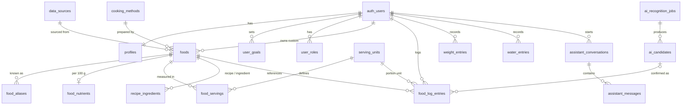

# NutriTrack — Database Design

Status: **Implemented in Stage 02.** The source of truth is the SQL in
[`supabase/migrations`](../supabase/migrations); this document explains it. Security behaviour is proven by
the pgTAP tests in [`supabase/tests/database`](../supabase/tests/database) (`pnpm db:test`).
TypeScript types are generated into `packages/types` (`pnpm db:types`).

Conventions:

- Primary keys `id uuid default gen_random_uuid()`. Log tables accept client-generated ids so offline sync replays are idempotent upserts (ADR-018).
- `created_at`, `updated_at timestamptz`; `updated_at` maintained by trigger.
- User-owned tables carry `user_id uuid not null default auth.uid() references auth.users on delete cascade`, so deleting an account removes all of the user's data (ADR-021).
- Nutrient amounts are `numeric` (exact decimals), not floats. Energy in kcal, macros in g, sodium in mg, water in ml, weight in kg.
- Unknown nutrient values are `null`, never 0 (ADR-011).
- RLS is **enabled on every table**. The `anon` role has no access to any app table, including tables added by future migrations (default privileges revoked).
- Functions use `set search_path = ''` and fully-qualified names.

| Migration                | Contents                                                                                                |
| ------------------------ | ------------------------------------------------------------------------------------------------------- |
| `…170000_foundations`    | `pg_trgm`, enums, `set_updated_at()`, anon default privileges revoked                                   |
| `…170100_users`          | `profiles` (+ sign-up trigger), `user_roles`, `is_admin()`, `user_goals`                                |
| `…170200_food_catalogue` | reference tables, `foods` and child tables, `food_submissions`, `can_edit_food()`                       |
| `…170300_logging`        | `food_log_entries` (+ snapshot trigger), `weight_entries`, `water_entries`                              |
| `…170400_ai`             | recognition jobs, candidates, assistant conversations and messages                                      |
| `…170500_billing`        | `entitlements`, `ai_usage`                                                                              |
| `…170600_audit`          | `audit_log` and triggers on all catalogue tables                                                        |
| `…170700_storage`        | private `meal-photos` bucket and owner-only policies                                                    |
| `…180000_onboarding`     | `profiles.strength_trains`; 18+ trigger; calorie-floor trigger on `user_goals`; `complete_onboarding()` |

---

## 1. Entity overview

## 2. Tables

### Users

| Table        | Key columns                                                                                                                                                                                    | Notes                                                                                              |
| ------------ | ---------------------------------------------------------------------------------------------------------------------------------------------------------------------------------------------- | -------------------------------------------------------------------------------------------------- |
| `profiles`   | `id` (= auth user id), display_name, sex, date_of_birth, height_cm, activity_level, strength_trains, onboarding_completed_at, health_data_consent_at, consent_version, photo_evaluation_opt_in | Created by trigger on sign-up. 18+ enforced by trigger. Photo evaluation is opt-in (default false) |
| `user_roles` | user_id, role (`admin`)                                                                                                                                                                        | No write policies: granted only with the service role                                              |
| `user_goals` | goal_type, target_weight_kg, target_rate_kg_per_week, calorie_target, protein_g, carbs_g, fat_g, water_ml, is_override, effective_from                                                         | History: insert-only; latest effective row is active. Broad sanity bounds only                     |

### Food catalogue

| Table                | Key columns                                                                                                             | Notes                                                                                       |
| -------------------- | ----------------------------------------------------------------------------------------------------------------------- | ------------------------------------------------------------------------------------------- |
| `data_sources`       | name, citation, url, licence, notes                                                                                     | Every verified food and every measured serving must reference one                           |
| `cooking_methods`    | name                                                                                                                    | Case-insensitive unique                                                                     |
| `serving_units`      | name, kind (mass/volume/count), grams_per_unit                                                                          | `grams_per_unit` only for universal units (gram = 1); otherwise per food in `food_servings` |
| `foods`              | name, category, cooking_method_id, is_composite, recipe_yield_grams, data_source_id, verification_status, owner_user_id | `owner_user_id` null = global (admin-managed); set = private custom food                    |
| `food_aliases`       | food_id, alias, language (en/yo/ig/ha/pcm)                                                                              | Trigram index for fuzzy search                                                              |
| `food_nutrients`     | food_id, energy_kcal, protein_g, carbs_g, fat_g, fibre_g, sugar_g, sodium_mg (per 100 g)                                | Same keys as `NUTRIENT_KEYS` in `packages/core`. Plausibility bounds enforced               |
| `food_servings`      | food_id, serving_unit_id, grams, is_estimate, data_source_id                                                            | Unit → grams per food (a wrap of eba ≠ a wrap of amala). Defaults to estimate               |
| `recipe_ingredients` | recipe_food_id, ingredient_food_id, grams                                                                               | Composite dishes; nutrients derived deterministically (Stage 04)                            |
| `food_submissions`   | submitted_by, payload, status, reviewer_notes, reviewed_by, reviewed_at                                                 | User submissions for admin review                                                           |

### Logging

| Table              | Key columns                                                                                                                                                | Notes                                                                                    |
| ------------------ | ---------------------------------------------------------------------------------------------------------------------------------------------------------- | ---------------------------------------------------------------------------------------- |
| `food_log_entries` | log_date, meal_slot, food_id, serving_unit_id, quantity, entry_method, ai_candidate_id; **snapshot:** food_name, grams, energy_kcal, protein_g … sodium_mg | Each entry stands alone (no parent meal row) so offline devices never conflict (ADR-029) |
| `weight_entries`   | measured_on, weight_kg                                                                                                                                     | One per user per day                                                                     |
| `water_entries`    | logged_at, amount_ml, unit_label                                                                                                                           |                                                                                          |

**Snapshot trigger (ADR-029).** On insert, or when food/unit/quantity change, the database computes
`grams = round(quantity × grams_per_unit, 2)` and `nutrient = round(per_100g × grams / 100, 2)` from the
catalogue. Client-supplied snapshot values are always overwritten. Editing other fields (e.g. moving an
entry to dinner) keeps the original snapshot even if the catalogue has since changed. Postgres `numeric`
rounding matches `roundTo()` in `packages/core`; both test suites assert the same examples. The lookup runs
with the user's permissions, so users can only log foods they can see.

### AI (written by Edge Functions with the service role)

| Table                     | Key columns                                                                                       | Notes                                |
| ------------------------- | ------------------------------------------------------------------------------------------------- | ------------------------------------ |
| `ai_recognition_jobs`     | input_type, input_text, photo_path, model, status, raw_output, error                              | Raw model output kept for review     |
| `ai_candidates`           | label, matched_food_id, suggested_quantity/unit, confidence, final_food_id/quantity/unit, outcome | Captures user corrections            |
| `assistant_conversations` | title                                                                                             | Users may delete their conversations |
| `assistant_messages`      | role, content, model, input_tokens, output_tokens                                                 |                                      |

Child rows reference their parent by `(id, user_id)`, so a candidate or message can never belong to a
different user than its parent.

### Billing (ADR-019, written by webhooks with the service role)

| Table          | Key columns                           | Notes                                    |
| -------------- | ------------------------------------- | ---------------------------------------- |
| `entitlements` | user_id, tier, source, valid_until    | No row = free tier                       |
| `ai_usage`     | user_id, feature, period_start, count | Free-tier AI limits enforced server-side |

### Admin

| Table       | Key columns                                            | Notes                                                                                   |
| ----------- | ------------------------------------------------------ | --------------------------------------------------------------------------------------- |
| `audit_log` | actor_id, action, table_name, record_id, before, after | Written by triggers on all catalogue tables. Users' private custom foods are not logged |

## 3. Access rules (RLS)

| Table group                                                    | Read                                                                     | Write                                                  |
| -------------------------------------------------------------- | ------------------------------------------------------------------------ | ------------------------------------------------------ |
| profiles                                                       | owner                                                                    | owner updates; created by trigger                      |
| user_goals                                                     | owner                                                                    | owner inserts (history, no updates)                    |
| food_log_entries, weight_entries, water_entries                | owner                                                                    | owner                                                  |
| foods and child tables (aliases, nutrients, servings, recipes) | global foods unless rejected (admins see rejected too); own custom foods | admins for global foods; owners for their custom foods |
| data_sources, cooking_methods, serving_units                   | any signed-in user                                                       | admins                                                 |
| food_submissions                                               | submitter and admins                                                     | submitter inserts as pending; admins review            |
| ai__, assistant__, entitlements, ai_usage                      | owner                                                                    | service role only (users may delete conversations)     |
| user_roles                                                     | own role; admins all                                                     | service role only                                      |
| audit_log                                                      | admins                                                                   | triggers only                                          |
| storage `meal-photos` (private, 5 MiB, images)                 | owner's folder `{user_id}/…`                                             | owner's folder                                         |

Helpers: `is_admin()` (security definer, reads `user_roles`) and `can_edit_food(food_id)`.
Even admins cannot read other users' profiles, logs or custom foods.

## 4. Integrity rules

- Users must be 18 or older (trigger on `profiles.date_of_birth`).
- Every goal, including a user override, must meet the calorie floor: 1,200 kcal (female) / 1,500 kcal (male; also when sex is unknown). Mirrors `packages/core` (ADR-031).
- Onboarding (profile, consent, first weigh-in, first goal) is saved in one transaction by `complete_onboarding()`; it runs with the user's permissions, so RLS and triggers still apply.

- `CHECK` constraints: quantity 0–10,000; grams > 0; weight 20–400 kg; water 1–5,000 ml per entry; height 50–272 cm; calorie target 500–10,000 (safety floors live in `packages/core`, ADR-024).
- Per-100 g plausibility: energy 0–900 kcal; protein/carbs/fat/fibre/sugar 0–100 g; sodium 0–40,000 mg.
- A food can only be `verified` with a data source; custom foods are always `unverified`.
- A serving weight can only be marked measured (not an estimate) with a data source.
- Logged foods cannot be deleted while referenced (deleting an account still works: the user's own entries and custom foods are removed together).

## Food catalogue data and search (Stage 04)

- **Reference data** (migration `20261111100000_food_search`): serving units, including Nigerian
  portions (wrap, derica, mudu, ladle, cooking spoon) with **no** universal gram weight, and cooking
  methods.
- **Catalogue seed**: `supabase/seed.sql` is **generated** by `scripts/build-food-seed.mjs` from
  `supabase/food-data/*.json` and USDA FoodData Central (CC0). Every food has a `data_source_id`;
  none is `verified` until dietitian review. Composite dishes come only from documented recipes
  (`recipes.json`), calculated by `recipePer100g` in `packages/core`. The seed runs on local
  `db reset` / `db start`; staging and production are loaded at release (Stage 10).
- **`search_foods(query, limit)`**: trigram word-similarity over names and aliases, one row per
  food with the best-matching alias and language. Security invoker, so foods RLS applies (users see
  global non-rejected foods and their own custom foods). Signed-in users only.
- **`create_custom_food(...)`**: creates a private, unverified food with nutrients and an optional
  serving in one transaction. Signed-in users only.

## 5. Commands

| Command         | What it does                                       |
| --------------- | -------------------------------------------------- |
| `pnpm db:start` | Start local Supabase (Docker) and apply migrations |
| `pnpm db:reset` | Rebuild the local database from migrations         |
| `pnpm db:test`  | Run the pgTAP security tests                       |
| `pnpm db:types` | Regenerate `packages/types/src/database.ts`        |
| `pnpm db:stop`  | Stop local Supabase                                |
