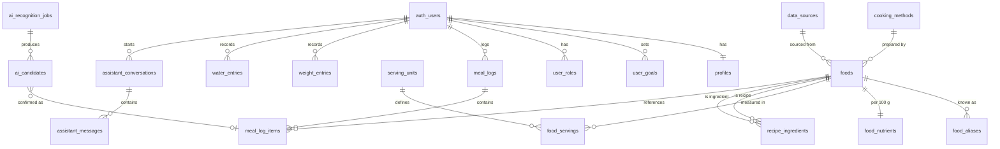

# NutriTrack — Database Design

Status: **Proposed — not yet migrated.** This becomes real only through migrations in `supabase/migrations`
(Stage 02). Column lists show intent, not final DDL.

Conventions:

- Primary keys `id uuid default gen_random_uuid()`. Log tables accept client-generated UUIDs so offline sync is idempotent (ADR-018).
- `created_at`, `updated_at timestamptz` on all mutable tables.
- User-owned tables carry `user_id uuid references auth.users(id) on delete cascade`.
- Nutrient amounts stored as `numeric`, not float. Energy in kcal, macros in grams, water in ml, weight in kg.
- RLS **enabled on every table**.

---

## 1. Entity overview

## 2. Tables

### Users

| Table        | Key columns                                                                                                                                                          | Notes                                |
| ------------ | -------------------------------------------------------------------------------------------------------------------------------------------------------------------- | ------------------------------------ |
| `profiles`   | `id` (= auth user id), display_name, sex, date_of_birth, height_cm, activity_level, unit_preference                                                                  | Created by trigger on sign-up        |
| `user_goals` | user_id, goal_type (lose/maintain/gain), target_weight_kg, target_rate_kg_per_week, calorie_target, protein_g, carbs_g, fat_g, water_ml, is_override, effective_from | History kept; latest row is active   |
| `user_roles` | user_id, role (`admin`)                                                                                                                                              | Only service role / admins can write |

### Food catalogue

| Table                            | Key columns                                                                                                                                                                               | Notes                                                      |
| -------------------------------- | ----------------------------------------------------------------------------------------------------------------------------------------------------------------------------------------- | ---------------------------------------------------------- |
| `data_sources`                   | name, citation, url, licence, notes                                                                                                                                                       | Every verified food must reference one                     |
| `cooking_methods`                | name (boiled, fried, roasted, stewed, raw, …)                                                                                                                                             |                                                            |
| `foods`                          | name, category, cooking_method_id, is_composite, data_source_id, verification_status (`verified`/`unverified`/`rejected`), owner_user_id (null = global; set = user's custom food), notes |                                                            |
| `food_aliases`                   | food_id, alias, language (en/yo/ig/ha/pcm)                                                                                                                                                | Powers search; trigram index                               |
| `food_nutrients`                 | food_id, energy_kcal, protein_g, carbs_g, fat_g, fibre_g, sugar_g, sodium_mg, … (all per 100 g, nullable)                                                                                 | Null = unknown, never 0 by default                         |
| `serving_units`                  | name (wrap, derica, mudu, cooking spoon, piece, plate, cup, sachet, bottle, gram), kind (mass/volume/count)                                                                               |                                                            |
| `food_servings`                  | food_id, serving_unit_id, grams, is_estimate, data_source_id                                                                                                                              | Unit → grams is per food (a wrap of eba ≠ a wrap of amala) |
| `recipes` / `recipe_ingredients` | recipe food_id, ingredient food_id, grams, cooked_yield_grams                                                                                                                             | For composite dishes; nutrients derived deterministically  |

### Logging

| Table            | Key columns                                                                                                                                                               | Notes                                           |
| ---------------- | ------------------------------------------------------------------------------------------------------------------------------------------------------------------------- | ----------------------------------------------- |
| `meal_logs`      | user_id, log_date, meal_slot (breakfast/lunch/dinner/snack)                                                                                                               | Unique (user_id, log_date, meal_slot)           |
| `meal_log_items` | meal_log_id, user_id, food_id, serving_unit_id, quantity, grams, **snapshot** of energy_kcal/protein_g/carbs_g/fat_g/…, entry_method (manual/text/photo), ai_candidate_id | Snapshot preserves history if catalogue changes |
| `weight_entries` | user_id, measured_on, weight_kg                                                                                                                                           |                                                 |
| `water_entries`  | user_id, logged_at, amount_ml, unit_label                                                                                                                                 |                                                 |

### AI

| Table                     | Key columns                                                                                                                                                                 | Notes                      |
| ------------------------- | --------------------------------------------------------------------------------------------------------------------------------------------------------------------------- | -------------------------- |
| `ai_recognition_jobs`     | user_id, input_type (text/photo), input_text, photo_path, model, status, raw_output jsonb, created_at                                                                       | Raw output kept for review |
| `ai_candidates`           | job_id, user_id, label, matched_food_id, suggested_quantity, suggested_unit_id, confidence, final_food_id, final_quantity, final_unit_id, outcome (accepted/edited/removed) | Captures user corrections  |
| `assistant_conversations` | user_id, title                                                                                                                                                              |                            |
| `assistant_messages`      | conversation_id, user_id, role, content, model, tokens                                                                                                                      |                            |

### Admin

| Table              | Key columns                                                        | Notes                                   |
| ------------------ | ------------------------------------------------------------------ | --------------------------------------- |
| `food_submissions` | submitted_by, payload jsonb, status, reviewed_by, reviewed_at      | User-submitted foods for review         |
| `audit_log`        | actor_id, action, table_name, record_id, before jsonb, after jsonb | Written by triggers on catalogue tables |

### Billing (ADR-019)

| Table          | Key columns                                                             | Notes                                    |
| -------------- | ----------------------------------------------------------------------- | ---------------------------------------- |
| `entitlements` | user_id, tier (free/premium), source (paystack/revenuecat), valid_until | Written only by server webhooks          |
| `ai_usage`     | user_id, feature, period_start, count                                   | Enforces free-tier AI limits server-side |

## 3. RLS summary

| Table group                                                                                       | Select                                                                 | Insert / Update / Delete                           |
| ------------------------------------------------------------------------------------------------- | ---------------------------------------------------------------------- | -------------------------------------------------- |
| profiles, user_goals, meal_logs, meal_log_items, weight_entries, water_entries, ai__, assistant__ | owner only (`user_id = auth.uid()`)                                    | owner only                                         |
| foods, food_aliases, food_nutrients, food_servings                                                | everyone: global foods with status ≠ rejected; owner: own custom foods | admin for global foods; owner for own custom foods |
| data_sources, cooking_methods, serving_units, recipes                                             | everyone                                                               | admin only                                         |
| user_roles, audit_log                                                                             | admin only                                                             | service role / triggers only                       |
| food_submissions                                                                                  | submitter (own) + admin                                                | submitter inserts; admin updates                   |
| storage `meal-photos`                                                                             | owner path prefix                                                      | owner path prefix                                  |

Admin check: a `security definer` function `is_admin()` reading `user_roles`, used in policies.

## 4. Indexes (initial)

- `food_aliases(alias)` and `foods(name)` — `pg_trgm` GIN for fuzzy search.
- `meal_logs(user_id, log_date)`, `meal_log_items(meal_log_id)`.
- `weight_entries(user_id, measured_on)`, `water_entries(user_id, logged_at)`.
- `ai_candidates(job_id)`.

## 5. Integrity rules

- `CHECK` quantity > 0, grams > 0, weight_kg within a plausible range, amount_ml > 0.
- `verification_status = 'verified'` requires `data_source_id` not null.
- Nutrient columns nullable; unknown ≠ zero.
- Deleting a food that has been logged is blocked; use `rejected`/archived status instead.
